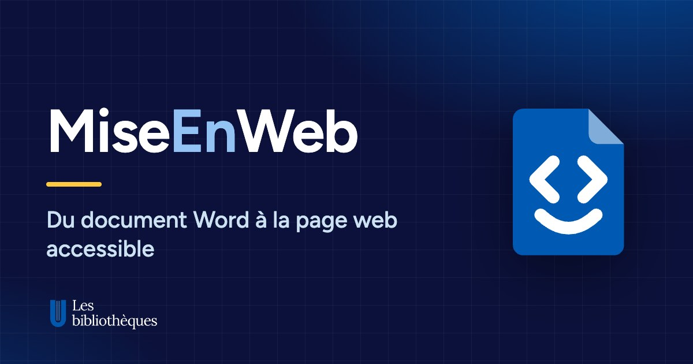

# MiseEnWeb

Convertit des documents Word (`.docx`) en pages web accessibles, directement dans le navigateur.
Aucune installation n'est requise, et les documents ne quittent jamais l'ordinateur.

Le convertisseur est écrit en Python. Pyodide l'exécute dans le navigateur.

## Démarrer

Requiert Node 22.12 ou une version plus récente.

```sh
npm install
npm run dev      # http://localhost:5173
npm run build    # site statique dans dist/
```

Au premier lancement, Pyodide et les bibliothèques Python (16 Mo) sont téléchargés dans
`public/pyodide/`.

## Structure

- `index.html` et `src/` : la page, son style et le worker qui exécute Python.
  - `src/assistant.ts` : l'assistant de création de profil.
  - `src/profil.ts` : l'ajout d'un profil à partir d'un fichier, et sa conservation dans le navigateur.
- `python/pont.py` : le lien entre la page et le convertisseur.
- `python/docx2html/`, `profils/`, `gabarits/` : le convertisseur, ses profils et ses gabarits.
  - `analyse.py` : relevé de ce que des documents ont en commun (styles, titres en gras, images).
  - `generateur.py` : écriture d'un profil d'après les réponses de l'assistant.
  - `validation.py` : vérification d'un profil, avec un message par erreur.
- `tests/` : les tests automatiques du convertisseur.

## Profils

Un profil contient les règles de conversion d'une publication : reconnaissance des documents, titres,
texte de remplacement des images, présentation de la page et des tableaux. C'est un fichier YAML.

- Les profils du site sont dans `python/profils/`. `defaut.yaml` sert d'exemple commenté.
- Dans la page, un profil s'ajoute à partir d'un fichier ou se crée avec l'assistant de création de
  profil. Il est validé, puis conservé dans le navigateur. Un seul profil ajouté à la fois.
- L'assistant compare les documents de la liste et pose ses questions en six écrans. Sans document,
  il en pose quatre : il règle alors la reconnaissance et la présentation seulement.

### Réglages d'un profil

Un profil simple a un en-tête et quatre sections. `python/profils/defaut.yaml` en est l'exemple commenté.

**En-tête**

| Réglage | Rôle |
|---|---|
| `nom` | Identifiant du profil : minuscules sans accent, chiffres et traits d'union. Obligatoire. |
| `description` | Phrase qui décrit le profil. |
| `revue` | Nom de la publication. Il paraît dans le menu « Règles ». |
| `issn` | ISSN de la publication, entre guillemets. Un document qui le porte en pied de page suit ce profil. |

**`detection` : reconnaissance des documents**

| Réglage | Rôle |
|---|---|
| `motif_nom_fichier` | Expression régulière cherchée dans le nom du fichier, sans égard aux majuscules. |
| `styles_presents` | Styles de paragraphe attendus dans le document. |
| `mode_styles` | `un` (au moins un des styles, par défaut) ou `tous`. |
| `priorite` | Nombre. Entre deux profils qui correspondent, le plus élevé l'emporte. |
| `defaut` | `true` pour le profil appliqué quand aucun autre ne correspond. Réservé à un profil du site. |

Un profil sans `detection` doit avoir un `issn` : l'ISSN seul suffit alors à le reconnaître.

**`mammoth` : passage du Word au HTML**

| Réglage | Rôle |
|---|---|
| `carte_styles` | Correspondance entre les styles de Word et les balises HTML, dans la [syntaxe de Mammoth](https://github.com/mwilliamson/python-mammoth#writing-style-maps). |
| `inclure_carte_defaut` | Conserve les correspondances d'origine de Mammoth (titres, listes, gras). |
| `images` | `incorporees` dans la page, ou `extraites` dans un dossier. |
| `ignorer_images_vides` | Écarte les images sans contenu. |
| `bordures_images` | Reproduit la bordure que Word donne à une image. |
| `images_connues` | Liste d'images de la publication. Chacune a son `empreinte` et son `alt`, le texte de remplacement. Un `alt` vide marque une image décorative. |

**`normalisation` : corrections faites sur une copie du Word**

| Réglage | Rôle |
|---|---|
| `active` | Active la section. |
| `numeros_sous_titres` | Écrit en texte le numéro des sous-titres numérotés. |
| `mise_en_forme_cellules` | Conserve le retrait et le centrage dans les tableaux. |
| `sortes_de_puces` | Conserve les puces particulières : coche, losange, tiret. |
| `regles` | Liste de règles. Un paragraphe qui remplit toutes les conditions d'une règle reçoit son style cible. La première règle qui s'applique l'emporte. |

Conditions d'une règle : `styles_source`, `gras`, `taille_min`, `taille_max` (points), `longueur_max`
(caractères), `mots_min`, `retrait_min` (points), `motif` (expression régulière), `premier_seulement`.
Résultat : `style_cible`, par exemple `Title`, `Heading 1` ou `Quote`. Chaque règle a un `nom`.

**`post_traitement` : structure et présentation de la page**

| Réglage | Rôle |
|---|---|
| `apparence` | `document` (titres et texte à gauche) ou `article` (titres centrés, texte justifié). |
| `tableaux` | `bordures`, `apa` ou `chicago`. |
| `tableaux_larges` | Nombre de colonnes à partir duquel un tableau défile dans sa zone. 0 : jamais. |
| `entetes_tableaux`, `notes_tableaux`, `accessibilite_tableaux`, `alignement_colonnes` | En-têtes, note sortie du tableau, titre et en-têtes reliés aux cellules, colonne centrée. |
| `bandeau_avant_titre`, `couleur_bandeau` | Conserve le bandeau placé avant le titre, avec sa couleur de fond. |
| `pied_page` | Reproduit le pied de page du document au bas de la page. |
| `resume_avant_mots_cles` | Replace le résumé avant ses mots-clés. |
| `decaler_niveaux` | `auto` : sous un titre de document, « Titre 1 » devient un titre de niveau 2. Ou un nombre. |
| `identifiants_titres`, `verifier_hierarchie`, `avertir_h1_multiples`, `corriger_faux_titres` | Ancre de chaque titre, contrôle des niveaux, titres vides retirés. |
| `gabarit_minimal` | Signale au rapport les éléments absents du manuscrit : logo dans l'en-tête, résumé, mots-clés, références, puis ISSN, licence et DOI dans le pied de page. Faux par défaut. |
| `table_des_matieres`, `niveau_max_tdm`, `titre_tdm`, `tdm_dans_fragment` | Table des matières de la page : niveau le plus profond, titre, présence dans un extrait sans gabarit. |
| `classe_titre_document` | Classe du titre principal, `titre-document` par défaut. |
| `liens_automatiques` | Rend cliquables les adresses web et les courriels. |
| `sens_ecriture` | Marque les passages en arabe. |
| `supprimer_vides` | Retire les paragraphes vides. |
| `gabarit` | `../gabarits/page.html`. Sans gabarit : un extrait de HTML, à insérer dans un site. |
| `langue` | Langue de la page, `fr` par défaut. |

Les valeurs permises pour `apparence` et `tableaux` sont les fichiers de `python/gabarits/apparence/`
et de `python/gabarits/tableaux/`. Ajouter un fichier `.css` ajoute une valeur.

**Profil à variantes**

Une publication qui a plusieurs sortes de documents écrit ses réglages partagés sous `commun`, puis
une entrée par sorte sous `variantes`. Chaque variante devient un profil nommé `nom/variante`.
`python/profils/science-infirmiere.yaml` en est l'exemple.

## Tester

Requiert Python 3. Les tests ont été exécutés avec Python 3.13.

```sh
python3 -m venv .venv
.venv/bin/pip install -r requirements-dev.txt
.venv/bin/pytest
```

Les tests créent leurs documents Word. Aucun document réel n'est conservé dans le répertoire GitHub.

## Publier

Le site est publié sur GitHub Pages à chaque envoi (`git push`) sur la branche `main`. La publication
s'active une seule fois, dans les réglages du répertoire GitHub : **Settings**, **Pages**, puis **Source** :
**GitHub Actions**.

## Licences

© 2026 Les bibliothèques de l'Université de Montréal

- **MIT** (fichier [`LICENSE`](LICENSE)) : le code, les profils, les gabarits et les exemples fictifs
  de `public/exemples/`.
- **[CC BY 4.0](https://creativecommons.org/licenses/by/4.0/deed.fr)** : la documentation (`README.md`,
  `DECLARATION-IA.md`), le logo et les icônes de MiseEnWeb (`public/logo.svg`, `public/icone-*.png`),
  l'image de partage (`public/partage.jpg`) et les captures d'écran (`public/captures/`). Ces fichiers
  font exception au fichier `LICENSE` : la mention « associated documentation files » de la licence
  MIT ne s'y applique pas.
- **Exclus** : le logo des Bibliothèques (`public/logo-bib.svg`, `public/logo-bib-blanc.svg`) est une
  marque de l'Université de Montréal. Aucune de ces licences ne le couvre, y compris là où il apparaît
  dans l'image de partage et les captures d'écran. Un utilisateur qui réutilise ce code doit le
  retirer ou le remplacer.

Les composants tiers conservent leur propre licence, indiquée dans
[`DECLARATION-IA.md`](DECLARATION-IA.md). Ce document décrit aussi l'utilisation de l'intelligence
artificielle générative.
