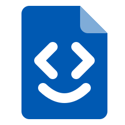
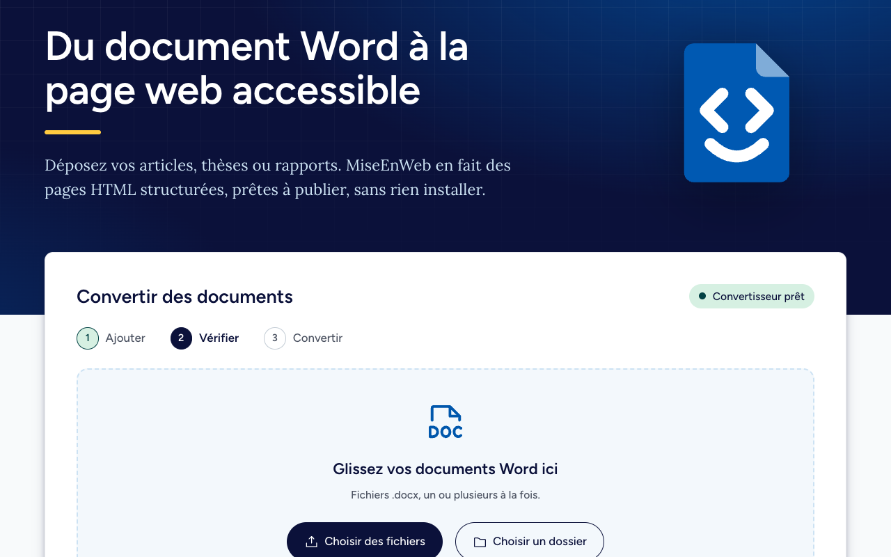

<p align="center"></p>

# MiseEnWeb, version web

Convertit des documents Word (`.docx`) en pages web accessibles, directement dans le navigateur.
Aucune installation n'est requise, et les documents ne quittent jamais l'ordinateur.

Le convertisseur est écrit en Python. [Pyodide](https://pyodide.org) l'exécute dans le navigateur.



## Démarrer

Requiert Node 22.12 ou une version plus récente.

```sh
npm install
npm run dev      # http://localhost:5173
npm run build    # site statique dans dist/
```

Au premier lancement, Pyodide et les bibliothèques Python (16 Mo) sont téléchargés dans
`public/pyodide/`.

## Organisation

- `index.html` et `src/` : la page, son style et le *worker* qui exécute Python.
- `python/pont.py` : le lien entre la page et le convertisseur.
- `python/docx2html/`, `profils/`, `gabarits/` : le convertisseur, ses profils et ses gabarits.

## Publier

Le site est publié sur GitHub Pages à chaque envoi (`git push`) sur la branche `main`. La publication
s'active une seule fois, dans les réglages du dépôt : **Settings**, **Pages**, puis **Source** :
**GitHub Actions**.

## Licences

© 2026 Les bibliothèques de l'Université de Montréal

- **MIT** (fichier [`LICENSE`](LICENSE)) : le code, les profils, les gabarits et les exemples fictifs
  de `public/exemples/`.
- **[CC BY 4.0](https://creativecommons.org/licenses/by/4.0/deed.fr)** : la documentation (`README.md`,
  `DECLARATION-IA.md`), le logo et les icônes de MiseEnWeb (`public/logo.svg`, `public/icone-*.png`),
  l'image de partage (`public/partage.jpg`) et les captures d'écran (`public/captures/`). Ces fichiers
  font exception au fichier `LICENSE` : la mention « associated documentation files » de la licence
  MIT ne s'y applique pas.
- **Exclus** : le logo et la favoricône des Bibliothèques (`public/logo-bib.svg`,
  `public/logo-bib-blanc.svg`, `public/favicon.svg`, `public/favicon.ico`) sont des marques de
  l'Université de Montréal. Aucune de ces licences ne les couvre, y compris là où ils apparaissent
  dans l'image de partage et les captures d'écran. Une personne qui réutilise ce code doit les
  retirer ou les remplacer.

Les composants tiers conservent leur propre licence, indiquée dans
[`DECLARATION-IA.md`](DECLARATION-IA.md). Ce document décrit aussi l'utilisation de l'intelligence
artificielle générative.
